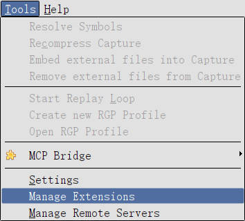
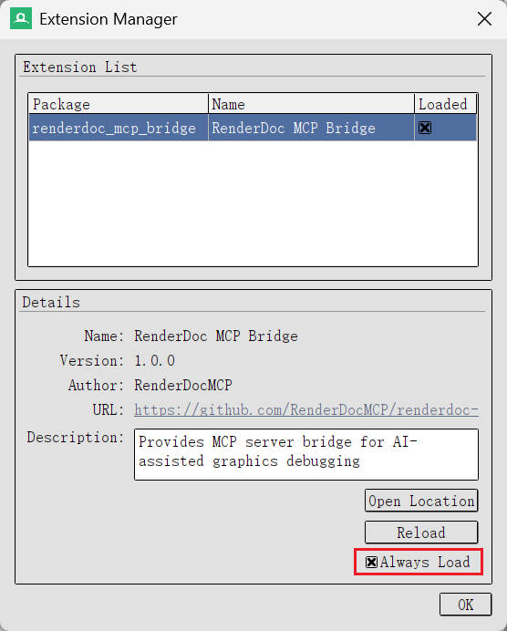

# RenderDoc MCP Server

作为 RenderDoc UI 扩展运行的 MCP 服务器。AI Agent 通过 MCP 访问 RenderDoc 的捕获数据，协助图形调试。

## 架构

```
AI Agent (MCP Client, stdio)
        │
        ▼
MCP Server Process (Python + FastMCP 2.0)
        │ File-based IPC (%TEMP%/renderdoc_mcp/)
        ▼
RenderDoc Process (Extension)
```

扩展运行在 Qt UI 线程上，直接用阻塞式 socket 会卡住界面、还要额外处理端口占用，因此通信采用基于文件的 IPC：扩展侧只依赖 `PySide2.QtCore.QTimer` 每 100ms 轮询请求文件，不使用任何网络模块。

## 安装配置

### 1. 安装RenderDoc扩展

```bash
python scripts/install_extension.py
```

扩展将安装到 `%APPDATA%\qrenderdoc\extensions\renderdoc_mcp_bridge`。

> 注意：重复安装是逐文件覆盖，`get_texture_saved` 生成在 `temp/` 下的图片会保留。

### 2. 在RenderDoc中启用扩展

1. 启动RenderDoc  


2. Tools > Manage Extensions  


3. 启用 "RenderDoc MCP Bridge"  

### 3. 安装MCP服务器

需要先有 [uv](https://docs.astral.sh/uv/)。如果执行 `uv --version` 提示找不到命令，先按平台安装：

```powershell
# Windows（PowerShell）
powershell -ExecutionPolicy ByPass -c "irm https://astral.sh/uv/install.ps1 | iex"
# 或使用 winget，避免执行远程脚本
winget install --id=astral-sh.uv -e
```

```bash
# macOS / Linux
curl -LsSf https://astral.sh/uv/install.sh | sh
```

也可以用 `pipx install uv` 或 `pip install uv`。装完重启 Shell，再注册 MCP 服务器：

```bash
uv tool install .            # 稳定版
uv tool install --editable . # 编辑模式：源码修改立即生效，开发时使用
uv tool update-shell         # 添加到PATH
```

重启Shell后即可使用 `renderdoc-mcp` 命令。

### 4. 配置 MCP 客户端

把 `renderdoc-mcp` 注册为 MCP 服务器即可。各客户端的字段结构一致，差别只在配置文件的位置：

- 项目级配置：项目根目录下的 `.mcp.json`（多数客户端识别该文件名）
- 客户端自带配置：例如 Claude Desktop 的 `claude_desktop_config.json`

内容都是：

```json
{
  "mcpServers": {
    "renderdoc": {
      "command": "renderdoc-mcp"
    }
  }
}
```

具体路径以你所使用客户端的文档为准。

## 使用方法

1. 启动RenderDoc,打开捕获文件 (.rdc)
2. 由 AI Agent 通过 MCP 客户端访问 RenderDoc 的数据

> 建议先调用 `ping` 确认扩展存活，再调用 `get_capture_status` 确认捕获是否已加载。

## MCP工具列表

| 工具 | 说明 |
|--------|------|
| **捕获管理** | |
| `ping` | 探测扩展是否存活 |
| `get_capture_status` | 检查捕获是否已加载 |
| `list_captures` | 列出目录内的 .rdc 文件 |
| `open_capture` | 打开捕获文件（会关闭当前捕获） |
| **DrawCall 与动作** | |
| `get_draw_calls` | 获取动作的层级列表 |
| `get_frame_summary` | 获取整帧概览 |
| `get_draw_call_details` | 获取单个绘制调用的详细信息 |
| `get_action_timings` | 获取动作的 GPU 执行时间 |
| **反查** | |
| `find_draws_by_shader` | 按着色器名反查绘制调用 |
| `find_draws_by_texture` | 按纹理名反查绘制调用 |
| `find_draws_by_resource` | 按资源 ID 反查绘制调用 |
| `find_draws_by_mesh` | 按网格（顶点/索引缓冲）名反查绘制调用 |
| **资源** | |
| `get_texture_info` | 获取纹理元数据 |
| `get_texture_raw` | 读取纹理原始像素（Base64） |
| `get_texture_saved` | 把纹理保存为 PNG |
| `get_buffer_contents` | 读取缓冲区内容（Base64） |
| **管线** | |
| `get_shader_info` | 获取着色器反汇编、常量缓冲值与资源绑定 |
| `get_pipeline_state` | 获取完整管线状态 |

### 参数说明

- `get_draw_calls`：
  - `include_children=false` 会把**所有标记一并丢掉**（标记只在"有子动作通过过滤"时才被保留，不再递归就没有子动作），结果退化成平铺的动作列表，Pass 结构完全消失。要按 Pass 取内容请用 `marker_filter`。
  - **标记自身的 `event_id` 落在其子动作的事件范围之外**（实测某帧标记为 6962-6971，子动作却分布在 152-6927），因此不要拿标记的 `event_id` 去设 `event_id_min` / `event_id_max`：绘制会被全部过滤掉，标记又因为没有子动作而被丢弃，最终返回空数组。
- `get_shader_info`：
  - `cbuffer_slots` 只返回指定常量缓冲槽位的值，**槽位是着色器反射里的索引（从 0 开始）**；未被选中的常量缓冲仍会出现在结果中，但带 `skipped: true` 且不含变量值。
  - `max_variables` 限制每个常量缓冲返回的变量数（默认 64，超出时结果带 `truncated` 标记），因此默认参数下**不是**"全部变量"。
  - `include_disassembly` 控制是否返回反汇编（默认 `true`）。
  - 常量缓冲可能包含数百个变量，按需限定可避免响应过大。
- `get_action_timings`：
  - `total_duration_ms` 是本次返回各事件耗时的**总和**（GPU 忙时累加），**不是帧时间**；加了过滤会相应变小。硬件不支持计时计数器时返回 `available: false`，不要当成"耗时为 0"。
  - 同一事件的计时**每次读都有抖动**（实测同一个 Dispatch 分别读到 2.615 ms 与 2.141 ms），只适合判断量级与相对占比，不要做精确对比。
- `find_draws_by_*`：需要逐 DrawCall 回放来遍历整帧，耗时随 DrawCall 数量增长，因此使用独立的超时上限。返回结构为 `{"matches": [{"event_id", "name", "match_reason"}], "total_matches", "scanned_draws"}`，其中 `match_reason` 形如 `"ShaderStage.Pixel SRV: 'CharacterSkin'"`。
  - `find_draws_by_shader` 的匹配目标是入口点名（通常是 `main`）或着色器资源名，用 `"main"` 这类通用词会命中几乎全部绘制，建议传入足够具体的关键词。
  - 四个反查工具都是全帧扫描，耗时接近，请把它们安排在单独的工具调用里，不要和别的调用并发（见下方"使用注意"）。
- `get_pipeline_state`：
  - 着色器绑定部分体积较大，如只需状态可用该工具配合 `get_shader_info` 的裁剪参数一起使用。
  - `include_cbuffer_variables`（默认 `true`）控制是否返回每个常量缓冲的变量列表。常量缓冲可能包含数百个变量、名字多为 `cb0_v1` 这类无意义编号，会显著放大响应体积；只关心槽位/大小时传 `false`，需要变量值请改用 `get_shader_info`。
  - 视口与裁剪最多各返回 16 项，超出的会被丢弃。
  - 某一状态块读取失败时，错误会写进 `errors`（键为该状态名，如 `errors.blend`），其余状态照常返回，不会让整个请求失败；混合、深度模板、视口裁剪、输入装配等均按 RenderDoc 1.46 的 `PipeState` 接口读取。

### 使用注意

- 扩展侧是**单请求通道**（固定的一组 `request.json` / `response.json`），同一时刻只能处理一个请求。请勿并行发起多个工具调用：并发调用会互相覆盖请求文件，先发出的请求只能等满超时（MCP 客户端通常会自动串行化同一服务器的调用，但不保证）。
- **不要同时开多个客户端**（例如 IDE 内的 MCP 服务器 + 一个跑脚本调试的进程）。被 MCP 客户端放弃的调用不会立刻停止：服务端会继续等响应直到超时为止，在此期间它会持续抢读 `response.json`，把本该给其他客户端的响应吃掉，表现出来就是别的调用莫名其妙超时。`find_draws_by_mesh` 的"超时"最可能就是这种情况，而同一个查询单独执行时却是正常的。
- 其他工具在首次调用前会自动做一次 `ping` 探测，因此 RenderDoc 未启动、扩展未加载时会立即报错，而不是白等满 120 秒。
- 环境变量只影响 MCP 服务器侧的等待时间，不会改变扩展的实际执行速度。

### 错误返回

所有工具通过 FastMCP 返回，失败时抛出异常，异常信息中带错误码：

| 错误码 | 含义 |
|--------|------|
| `-32601` | 请求的方法不存在（扩展版本与 MCP 服务器不匹配） |
| `-32602` | 参数不合法，例如缺少必填参数、`resource_id` 格式错误、`event_id` 无对应动作、mip/slice/sample 越界 |
| `-32000` | 扩展侧执行失败（未加载捕获、RenderDoc API 报错等） |

MCP 服务器侧还可能抛出：

- `找不到 IPC 目录 ...`：RenderDoc 未启动，或扩展未加载（扩展启动时会创建该目录）。
- `RenderDoc MCP Bridge 未响应 ...`：首次调用前的连通性探测失败，说明扩展没有在轮询请求文件。
- `请求超时(Ns) ...`：请求已下发但超时未收到响应，通常说明该查询确实耗时过长，可调大超时或缩小查询范围。

### 环境变量

| 变量 | 默认值 | 说明 |
|--------|--------|------|
| `RENDERDOC_MCP_TIMEOUT` | `120` | 常规请求超时（秒） |
| `RENDERDOC_MCP_SEARCH_TIMEOUT` | `300` | 整帧反查类请求超时（秒），用于 `find_draws_by_*` |
| `RENDERDOC_MCP_PROBE_TIMEOUT` | `5` | 首次调用前连通性探测的超时（秒） |

> 通信基于文件 IPC，不占用端口，因此 `RENDERDOC_MCP_HOST` / `RENDERDOC_MCP_PORT` 已废弃。

## 使用示例

### 连通性自检

```
ping()
# → {"status": "ok", "ipc_dir": "...", "polling": true}
```

### 获取DrawCall列表

```
get_draw_calls(include_children=true)
```

### 获取着色器信息

```
# 反汇编 + 常量缓冲的值（每个常量缓冲默认最多 64 个变量，超出时带 truncated 标记）
get_shader_info(event_id=123, stage="pixel")

# 只读取 4 号常量缓冲的值，并跳过反汇编（常量缓冲变量很多时推荐）
get_shader_info(event_id=123, stage="pixel", cbuffer_slots=[4], include_disassembly=false)
```

### 获取管线状态

```
get_pipeline_state(event_id=123)
```

### 获取纹理数据

```
# 推荐：保存为PNG文件（避免响应大小超限）
get_texture_saved(resource_id="ResourceId::123")
# 返回: {"file_path": "...", "file_url": "file:///...", "width": 1920, "height": 1080, ...}

# 获取特定的mip级别
get_texture_saved(resource_id="ResourceId::123", mip=2)

# 获取立方体贴图的特定面 (0=X+, 1=X-, 2=Y+, 3=Y-, 4=Z+, 5=Z-)
get_texture_saved(resource_id="ResourceId::456", slice=3)

# 获取3D纹理的特定深度切片
get_texture_saved(resource_id="ResourceId::789", depth_slice=5)

# 原始Base64数据（仅适用于小纹理，Base64 会把体积放大约 1/3，大纹理请改用 get_texture_saved）
get_texture_raw(resource_id="ResourceId::123", mip=2)
```

> `get_texture_saved` 生成的 PNG 会累积在扩展安装目录的 `temp/` 下，目前不会自动清理，请自行按需删除。

### 部分获取缓冲区数据

```
# 获取整个缓冲区
get_buffer_contents(resource_id="ResourceId::123")

# 从偏移256处获取512字节
get_buffer_contents(resource_id="ResourceId::123", offset=256, length=512)
```

## 系统要求

- Python 3.10+
- [uv](https://docs.astral.sh/uv/)
- RenderDoc 1.46（管线状态相关 API 按 1.46 的 `PipeState` 接口实现，早期版本命名不同、未做兼容）

> **注意**: 仅在 Windows + DirectX 11 环境下进行过测试。
> Linux/macOS + Vulkan/OpenGL 环境可能也能运行，但未经验证。

## 许可证

MIT
